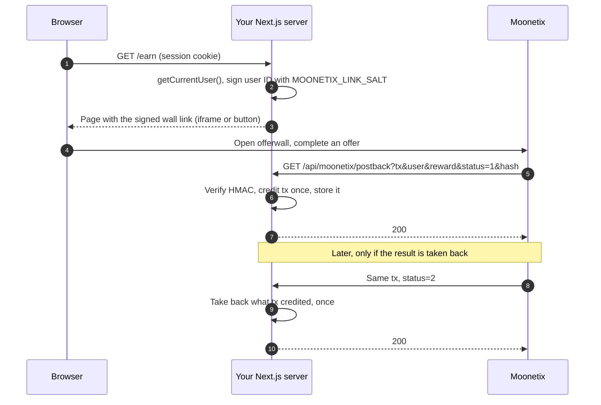

# Moonetix Offerwall Next.js Starter

**A Next.js App Router starter for the Moonetix offerwall: a signed link, an Earn page, and a postback route that credits each reward exactly once.**

[](https://github.com/moonetix/offerwall-nextjs-starter/actions/workflows/ci.yml)
[](LICENSE)
[](https://moonetix.com/academy/integrations/nextjs-react-offerwall)
[](https://moonetix.com/industries/web-apps)
[](https://docs.moonetix.com/offerwall-link)
[](https://moonetix.com/register?from=github-offerwall-nextjs-starter)

> **Get your App ID and keys: sign up free at [https://moonetix.com/register](https://moonetix.com/register?from=github-offerwall-nextjs-starter)**

Moonetix is an affiliate network. You add its offerwall to your app, your users earn your own currency (coins, points, gems) by completing offers, and you earn for every completed offer. This starter is a working Next.js App Router project with the whole loop wired up: it signs the offerwall link for the signed-in user, shows the wall, and receives the signed postback that credits or reverses coins.

## What you get

1. **Secrets stay on the server.** The link is signed in a `server-only` module, so importing it into a Client Component fails the build instead of leaking your salt.
2. **No double credits, no lost reversals.** The postback route checks the HMAC in constant time, credits each `transaction_id` once, and a reversal takes back exactly what was credited. Tested with real postbacks from the Moonetix code.
3. **Swap two files and ship.** Replace `lib/auth.ts` with your auth (NextAuth, Clerk, your own) and `lib/store/index.ts` with your database. The credit rules stay in one place and do not change.

## Quick start

You need Node.js 22.13 or later and a Moonetix app ([sign up](https://moonetix.com/register?from=github-offerwall-nextjs-starter), then create an offerwall).

```bash
git clone https://github.com/moonetix/offerwall-nextjs-starter.git
cd offerwall-nextjs-starter
npm install
cp .env.example .env.local
```

Fill in `.env.local`:

| Variable | Required | Default | What it does |
| --- | --- | --- | --- |
| `MOONETIX_APP_ID` | yes | none | App ID. Dashboard: Offerwalls, your offerwall, Integration. |
| `MOONETIX_LINK_SALT` | yes | none | Link hash salt, same page. Signs the `user_id` in the wall link. |
| `MOONETIX_POSTBACK_KEY` | yes | none | Postback secret key, Postback page under Incentive tools. |
| `MOONETIX_STORE_FILE` | no | `.data/moonetix-store.json` | Where the JSON file store keeps balances in development. |
| `MOONETIX_FLOATING_BUTTON` | no | `on` | `off` hides the floating "Earn coins" button; `embed.js` still loads for pop-up links. |
| `MOONETIX_DEMO_USER` | no | unset | `allow` lets the demo user run under `NODE_ENV=production`, for a local `npm start` only. |

The keys are read when a link is built or a postback arrives, so `next build` works without them.

```bash
npm run dev
```

Open http://localhost:3000/earn. You are signed in as a demo user. The iframe stays blank on localhost (the wall only loads in frames on https pages of the website you registered), so use the "open it in a new tab" link on the page.

Then register this postback URL on the Postback page of your dashboard:

```
https://yoursite.com/api/moonetix/postback?tx={transaction_id}&user={user_id}&reward={reward}&status={status}&hash={hash}
```

## How it works



1. `app/earn/page.tsx` is a Server Component. It gets the user from `getCurrentUser()` (your session), never from the URL.
2. `lib/moonetix.ts` signs the user ID: HMAC-SHA256 with your link hash salt, as lowercase hex. Only the finished link goes to the browser.
3. The page shows the wall in an iframe. `<MoonetixEmbed>` in the layout loads `embed.js`, which adds an optional floating "Earn coins" button and opens the wall in a pop-up for any link with `data-moonetix-open=""`.
4. When an advertiser confirms a result, Moonetix calls `app/api/moonetix/postback/route.ts` with status `1`.
5. The route verifies `hash` (HMAC-SHA256 of `tx:user:reward:status` with your postback secret key) with `crypto.timingSafeEqual`, after a length check. Bad or missing values get `403`.
6. `applyEvent()` in `lib/moonetix-core.ts` credits the reward once per `transaction_id`, inside one store transaction, then the route answers `200`.
7. If a result is reversed later, the same `transaction_id` arrives with status `2`. The starter takes back the stored reward from the stored user, once. A reversal for a transaction you never credited is recorded, so a late credit cannot pay.
8. When the user returns to the tab, `<RefreshOnReturn>` re-renders the page so the balance is current.

## Project layout

```
app/
  earn/page.tsx                    Earn page: balance, history, iframe
  page.tsx                         Home: balance and your own pop-up button
  layout.tsx                       Loads embed.js (floating button, optional)
  api/moonetix/postback/route.ts   Postback endpoint
components/                        Iframe, EarnLink, embed script, refresh on return
lib/
  auth.ts                          REPLACE: getCurrentUser() placeholder
  moonetix.ts                      Server-only: reads env, signs links
  moonetix-core.ts                 Framework-free: link, hash check, credit rules
  store/types.ts                   The store interface (and a SQL schema)
  store/json-file-store.ts         Default store for local development
  store/sqlite-store.ts            SQL example store on node:sqlite
  store/index.ts                   REPLACE for production: pick your store
test/postback.test.ts              Tests that run in plain Node
```

## Connect your auth

`lib/auth.ts` returns a fixed demo user so the project runs. Replace `getCurrentUser()` with your session lookup and return `{ id, name }` or `null`. Use your database ID: stable, 1 to 100 characters from `A-Z a-z 0-9 . _ @ : + -`, never an email or a username. In production the demo user throws an error on purpose, so you cannot ship it by accident.

## Use your database

The JSON file store is for local development only: one process, and serverless hosts have no lasting disk. For production, implement the `RewardStore` interface in `lib/store/types.ts` with your database and return it from `lib/store/index.ts`. A store only has to run a callback in one atomic transaction and offer five small operations. The credit rules stay in `applyEvent()`.

- `lib/store/types.ts` has a SQL schema that works for PostgreSQL, MySQL and SQLite, and notes for Prisma and Drizzle.
- `lib/store/sqlite-store.ts` is a complete SQL example. The tests run the same rules against both stores.
- Keep `transaction_id` as the primary key. If two copies of one postback race, one insert fails, the route answers `500`, and the retry sees the row and skips it.

## Security notes

- The salt and the postback key never get a `NEXT_PUBLIC_` prefix and are only read in `server-only` modules.
- The link is built on the server for the signed-in user. The browser never sends a user ID to sign.
- The postback hash is checked before anything else, in constant time. Each parameter must appear exactly once.
- Each `transaction_id` is credited once. Status `2` takes back only what was credited for that transaction.
- The route answers `200` only after the change is stored, `500` on your own failures so Moonetix retries (up to 5 times), and never redirects. Keep the path out of any proxy or middleware that redirects signed-out visitors.
- Reward only completed offers. Never reward joins, invites, likes, reviews or other engagement. Your users must be 16 or older.
- A reversed reward can push a balance below zero if the user spent it. Decide how you handle that (negative balance or held withdrawals) and say so in your terms.

## Test it

Unit and integration tests run in plain Node, no Next.js needed:

```bash
npm test
```

They check the wall link, credits, retries, reversals, reversal before credit, ten parallel copies of one credit, tampered and missing parameters, wrong keys, and test postbacks, against both stores.

Send a signed postback to your local server (sample values only):

```bash
export MOONETIX_POSTBACK_KEY=your_postback_secret_key
TX=local_1 U=demo-user-1 R=150 S=1
HASH=$(node -e "console.log(require('node:crypto').createHmac('sha256', process.env.MOONETIX_POSTBACK_KEY).update(process.argv[1]).digest('hex'))" "$TX:$U:$R:$S")
curl -i "http://localhost:3000/api/moonetix/postback?tx=$TX&user=$U&reward=$R&status=$S&hash=$HASH"
```

Run it twice: the demo user gains 150 coins once. Change `S=2` to reverse it.

Before you deploy, run [postback-tester](https://github.com/moonetix/postback-tester) against `npm run dev`. It signs postbacks exactly like Moonetix and sends a credit and its retry, three kinds of reversal, four forged or unsigned requests and five parallel copies of one credit, then exits 1 if the route gets any of them wrong. Its transaction IDs start with `test_`, which the route verifies and logs without crediting, so the run checks the signature handling and the answers; `npm test` covers the balances. It reads `MOONETIX_POSTBACK_KEY` from the environment, so export the value from `.env.local` first:

```bash
npx github:moonetix/postback-tester --preset moonetix \
  'http://localhost:3000/api/moonetix/postback?tx={transaction_id}&user={user_id}&reward={reward}&status={status}&hash={hash}'
```

From the Moonetix dashboard, once your route is reachable over the internet (deployed, or through a tunnel):

1. Go to Offerwalls, your offerwall, Integration, and click **Send a test postback**, or use the Postback page.
2. Send one with status 1 and one with status 2.
3. Test transaction IDs start with `test_`. The route answers `200` and logs them without crediting.
4. Every attempt and your server's answer is listed under Reports, Postbacks.

## When something is off

| Symptom | Cause and fix |
| --- | --- |
| `/earn` errors with `MOONETIX_APP_ID is not set. Copy .env.example to .env.local and fill it in.` | `.env.local` is missing or the dev server started before you saved it. Fill it in and restart `npm run dev`. |
| `lib/auth.ts still returns the demo user. Connect your auth library first.` | You ran `npm start` (production) with the placeholder auth. Connect your auth, or set `MOONETIX_DEMO_USER=allow` for a local check. |
| Postback answers `403`, log shows `moonetix: rejected postback (bad_hash)` | Wrong `MOONETIX_POSTBACK_KEY`, or a proxy rewrote a value. The hash covers `tx:user:reward:status` exactly as received. |
| Postback answers `403`, log shows `(bad_request)` | A parameter is missing or appears twice. Copy the postback URL above exactly, including `hash={hash}`. |
| Postback answers `200` but no coins | `test_` transactions and signed postbacks with an unusable user ID or reward are logged and skipped on purpose. Check the log line. |
| Postback answers `500` or a redirect | The store failed (the JSON file store on a host with a read-only disk), or middleware redirects the route. Use a database store and exclude `/api/moonetix/postback` from auth middleware. |

Free tools that help: the [offerwall link builder](https://moonetix.com/tools/offerwall-link-builder) shows the exact link your server should build for a user ID, and the [postback hash checker](https://moonetix.com/tools/postback-hash-checker) recomputes a postback signature.

## Learn more

- [Next.js and React offerwall guide](https://moonetix.com/academy/integrations/nextjs-react-offerwall) (Moonetix Academy): the step by step version of this starter.
- [Offerwall link docs](https://docs.moonetix.com/offerwall-link): link format, iframe, floating button, error pages.
- [Postback docs](https://docs.moonetix.com/postbacks): macros, statuses, hash, retries.
- [Credits and reversals](https://docs.moonetix.com/credits-and-reversals) and [Testing](https://docs.moonetix.com/testing).
- [Moonetix for web apps](https://moonetix.com/industries/web-apps).

## More Moonetix examples

- **Start here:** [awesome-offerwalls](https://github.com/moonetix/awesome-offerwalls), [offerwall-postback-handlers](https://github.com/moonetix/offerwall-postback-handlers)
- **SDKs:** [moonetix-android-sdk](https://github.com/moonetix/moonetix-android-sdk), [moonetix-ios-sdk](https://github.com/moonetix/moonetix-ios-sdk), [moonetix-flutter](https://github.com/moonetix/moonetix-flutter), [moonetix-react-native](https://github.com/moonetix/moonetix-react-native), [moonetix-unity](https://github.com/moonetix/moonetix-unity)
- **Web and backends:** [offerwall-react-vite](https://github.com/moonetix/offerwall-react-vite), [offerwall-vue-nuxt](https://github.com/moonetix/offerwall-vue-nuxt), [offerwall-express](https://github.com/moonetix/offerwall-express), [offerwall-laravel](https://github.com/moonetix/offerwall-laravel), [offerwall-django](https://github.com/moonetix/offerwall-django), [offerwall-firebase-functions](https://github.com/moonetix/offerwall-firebase-functions), [offerwall-supabase](https://github.com/moonetix/offerwall-supabase), [rewards-site-starter](https://github.com/moonetix/rewards-site-starter), [moonetix-offerwall-wordpress](https://github.com/moonetix/moonetix-offerwall-wordpress)
- **Apps and games:** [offerwall-flutter-example](https://github.com/moonetix/offerwall-flutter-example), [offerwall-react-native-example](https://github.com/moonetix/offerwall-react-native-example), [offerwall-unity-example](https://github.com/moonetix/offerwall-unity-example), [offerwall-godot](https://github.com/moonetix/offerwall-godot), [offerwall-html5-game](https://github.com/moonetix/offerwall-html5-game)
- **Communities and desktop:** [telegram-mini-app-offerwall](https://github.com/moonetix/telegram-mini-app-offerwall), [discord-rewards-bot](https://github.com/moonetix/discord-rewards-bot), [offerwall-chrome-extension](https://github.com/moonetix/offerwall-chrome-extension), [offerwall-electron](https://github.com/moonetix/offerwall-electron)
- **Tools and data:** [postback-tester](https://github.com/moonetix/postback-tester), [signup-guard](https://github.com/moonetix/signup-guard), [datacenter-ip-ranges](https://github.com/moonetix/datacenter-ip-ranges), [reward-economy-kit](https://github.com/moonetix/reward-economy-kit), [referral-engine](https://github.com/moonetix/referral-engine), [gamification-kit](https://github.com/moonetix/gamification-kit), [offerwall-fraud-playbook](https://github.com/moonetix/offerwall-fraud-playbook), [affiliate-postback-macros](https://github.com/moonetix/affiliate-postback-macros), [country-tiers](https://github.com/moonetix/country-tiers)

## License

[MIT](LICENSE). Copyright (c) 2026 Moonetix.

---

**Ready to go live? Get your App ID and keys: sign up free at [https://moonetix.com/register](https://moonetix.com/register?from=github-offerwall-nextjs-starter)**
